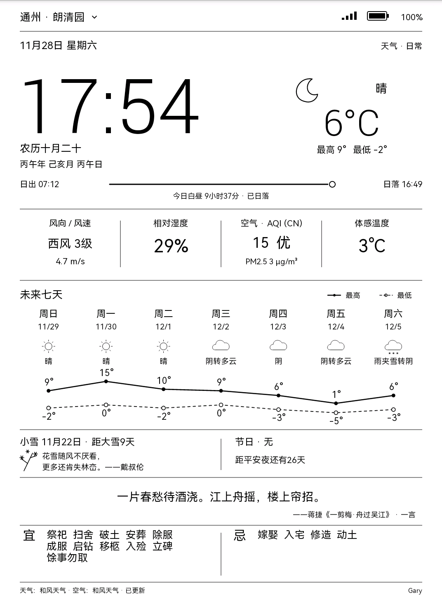

# 智能天气墨水屏

把刷入 Android 的 Kindle 变成桌面天气时钟。以黑白界面呈现天气、空气质量、农历节气和每日句子，适合放在书桌或床头查看。

客户端直连和风天气，无需自建天气服务端。支持 Android 4.2 及以上，已在 Kindle Android 4.4.2 上使用。

## 界面预览



## 主要功能

- **天气与空气**：实时天气、体感温度、湿度、风向风速，七日最高最低温趋势曲线；显示空气质量指数、对应标准、PM2.5 浓度与空气等级，日光进度条呈现日出日落与倒计时。
- **时钟与农历**：大字分钟时钟、公历日期、星期、农历日期和干支年月日，统一使用北京时间。
- **节气与节日**：显示交节日期、下个节气倒计时和节日倒计时，节气诗句每天轮换，保留黄历宜忌。
- **每日句子**：混合文学、诗词和哲理短句，显示作者与出处，随天气更新。
- **墨水屏适配**：现代报纸、书刊、极简、复古仪表四种黑白风格可切换；按屏幕尺寸等比缩放，支持定时黑白刷新，显示 Wi-Fi 信号与电量。
- **离线可用**：缓存最近一次数据，联网失败时保留画面；提供带明确标记的离线演示模式。

内置北京、上海、广州、深圳、杭州、成都、武汉、泰安、烟台、威海、新加坡、新汶和北京市通州区朗清园共 13 个地点。

## 安装与配置

应用需要 Android 系统，不能直接安装在 Kindle 原生系统上。

安装 APK 后，长按画面或点击右上角打开设置：

1. 在[和风天气控制台](https://console.qweather.com/)获取账户专属 **API Host** 和 **API Key**，填入对应设置项。API Key 与凭据 ID 不同。
2. 确认账户可使用城市实时天气、10 日天气预报和实时空气质量产品。应用从 10 日预报中选取未来七天显示。
3. 设置黄历服务地址，默认使用 `https://kindle.pptxgen.com`。
4. 设置联网刷新间隔，点击“保存并连接”；点击左上角可切换地点。

Host 和 API Key 保存在设备的应用私有配置中，项目不内置个人凭据。

点击右上方日期行的风格名称，或在设置中选择“切换界面风格”，即可更换主题，重启后保留选择。

| 风格 | 视觉特点 |
| --- | --- |
| 现代报纸 | 细体大时钟、线条图标与清晰分栏，默认风格 |
| 书刊 | 衬线数字、双细线和书摘引号 |
| 极简 | 减少分隔线与装饰，保留时间、天气及日历信息 |
| 复古仪表 | 默认线段时钟、仪表边框、日光刻度与温度网格 |

点击时钟可切换数字字形，每种主题分别记住选择；点击天气区域可查看今日天气详情。天气图标随日出日落切换日间与夜间样式。

联网更新只在应用前台进行，默认间隔 30 分钟，可设置为 60 秒至 7 天。分钟时钟独立更新；节气、节日倒计时在本地计算。应用运行时保持屏幕常亮，作为长期看板使用时可关闭前光、延长联网间隔以减少耗电。

## 数据来源

| 内容 | 来源 |
| --- | --- |
| 天气实况、体感、预报、空气质量 | [和风天气 QWeather](https://www.qweather.com/) |
| 黄历宜忌与当日黄历信息 | `kindle.pptxgen.com`，可配置其他兼容服务 |
| 文学、诗词与哲理短句 | [一言](https://developer.hitokoto.cn/sentence/) |
| 节气时刻与节日日期计算 | [lunar-java](https://github.com/6tail/lunar-java)，本地计算 |
| 节气诗句 | 内置诗库，原文与署名参考[维基文库](https://zh.wikisource.org/) |

空气质量优先使用中国标准 `AQI (CN)`，其他地区显示接口提供的指数名称与等级。PM2.5 为独立的浓度数据，单位为 μg/m³。缺失的指标显示 `--`。

自定义黄历服务需兼容 `kindle-dashboard-json/1` 协议，通过 `/v1/dashboard?city=<中文城市名>` 返回当日 `almanac` 数据。天气与空气数据直接由和风获取。

## 从源码构建

项目使用原生 Java 和 Canvas，基于 1072×1448 画布绘制。

需要 JDK 17、Android SDK Platform 33；构建工具使用 Android Gradle Plugin 8.7.3 和 Gradle 8.9。用 Android Studio 打开项目并配置 SDK，或参考 `local.properties.example` 创建本地配置，确保命令行的 `JAVA_HOME` 指向 JDK 17。

Windows：

```powershell
.\gradlew.bat :app:assembleDebug
```

macOS / Linux：

```sh
sh gradlew :app:assembleDebug
```

构建产物为 `app/build/outputs/apk/debug/app-debug.apk`。连接设备后可通过 ADB 安装：

```sh
adb install -r app/build/outputs/apk/debug/app-debug.apk
```

项目启动脚本会下载所需的 Gradle 分发包，依赖仓库已配置国内镜像。
