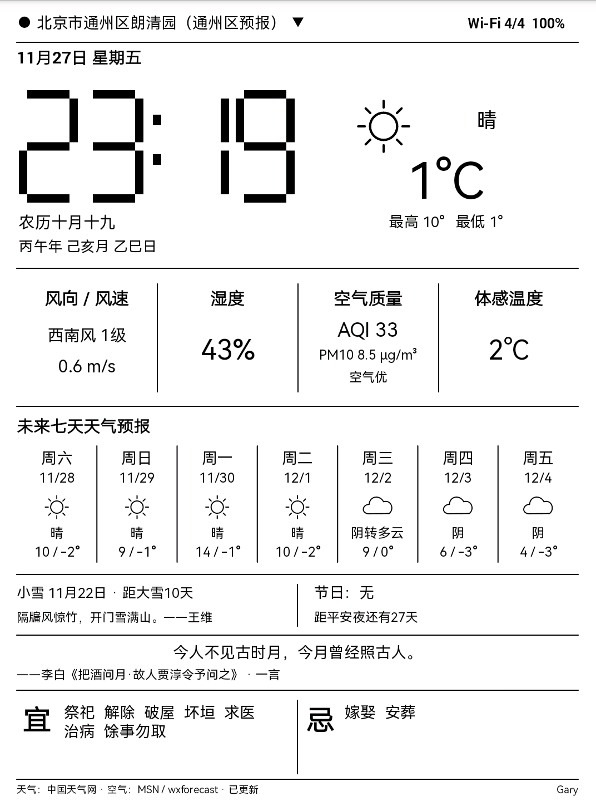

# 智能天气墨水屏

面向 Android 墨水屏设备的天气信息看板，使用原生 Java 和 Canvas 绘制黑白界面。客户端直接获取并解析中国天气网的实况和七日预报，通过 MSN 获取 wxforecast 空气数据及 MSN 体感温度，黄历继续使用现有 JSON 接口，也可使用离线演示模式查看界面。

## 功能

- 显示城市、日期、分钟时钟、天气、温度、体感、湿度与风速。
- 显示 AQI、首要污染物及浓度、七日天气预报和黄历信息。
- 大时钟下方显示农历日期和干支年月日；下方节气、节日分左右两列，以竖线分隔，节气下显示相关诗句与作者；原吉凶时区域改为一言句子与出处，保留宜忌。
- 提供 13 个预置地点（含北京市通州区朗清园），支持配置黄历接口地址和刷新间隔。
- 按数据源、城市和黄历接口保存本地缓存，天气实况请求失败时保留已有画面。
- 根据接口更新时间、实际观测时间和服务端标记提示天气数据过期。
- 支持离线演示，并明确标注演示数据。
- 显示网络类型、Wi-Fi 信号与电量，运行期间保持屏幕常亮。
- 使用 1072×1448 基准画布，等比缩放并居中显示，支持应用层黑白切换刷新。

数据轮询仅在应用前台运行时执行，默认每 30 分钟刷新一次，可设置为 60–604800 秒。

句子使用[一言语句接口](https://developer.hitokoto.cn/sentence/)，请求 `https://v1.hitokoto.cn/?c=d&c=i&c=k&min_length=8&max_length=36`，混合文学、诗词与哲学分类，无需 API Key。上行显示正文，下行显示接口返回的作者（若有）、出处与“一言”来源。随天气刷新请求新句子；最近一次成功结果单独保存，并写入看板缓存，请求失败时继续显示上次内容。首次无缓存且请求失败时正文显示 `--`，不填充虚构内容。此区域与节气专属诗句独立。

Kindle Android 4.4.2 实测：构建并安装后，设备 HTTPS 请求成功，23:19 截图显示“今人不见古时月，今月曾经照古人。”及李白与作品出处，两行完整，宜忌正常显示；设备本地 `hitokoto.xml` 已保存此次真实响应。未运行 lint 或单元测试。

### Kindle 实机截图



## Android 与应用版本

| 配置 | 值 |
| --- | --- |
| applicationId | `com.github.ronghuaxueleng.kindleaidashboard` |
| namespace | `com.github.ronghuaxueleng.remoteeink` |
| minSdk | 17（Android 4.2） |
| targetSdk | 28（Android 9） |
| compileSdk | 33（Android 13） |
| versionCode | 17 |
| versionName | 1.0.7 |

构建工具使用 Android Gradle Plugin 8.7.3、Gradle 8.9、JDK 17。JDK 17 是电脑上的构建要求，设备最低系统版本为 Android 4.2。应用使用原生 Android/Java API，交节时刻和节日日期由 [lunar-java 1.7.8](https://github.com/6tail/lunar-java)（MIT）离线计算，无传递运行时依赖。

## 工程结构

```text
天气/
├── settings.gradle
├── build.gradle
├── gradle.properties
├── gradlew / gradlew.bat
├── local.properties.example
├── tools/                         # Gradle 下载与项目检查脚本
└── app/
    ├── build.gradle
    ├── proguard-rules.pro
    └── src/
        ├── main/
        │   ├── AndroidManifest.xml
        │   ├── java/com/github/ronghuaxueleng/remoteeink/
        │   │   ├── MainActivity.java          # 生命周期、设置与刷新调度
        │   │   ├── DashboardCanvasView.java   # 看板绘制与触摸交互
        │   │   ├── DashboardLayout.java       # 排版、格式化与过期判断
        │   │   ├── SeasonalCalendar.java      # 交节日期、节气轮换与节日倒计时
        │   │   ├── DashboardFetcher.java      # 天气和黄历网络请求
        │   │   ├── ChinaWeatherJson.java      # 中国天气网数据转换
        │   │   ├── MsnWeatherJson.java        # MSN 空气与体感数据转换
        │   │   ├── DashboardCache.java        # 本地缓存
        │   │   ├── DashboardJson.java         # 协议解析与数据模型
        │   │   └── DemoData.java              # 离线演示数据
        │   └── res/
        └── test/java/com/github/ronghuaxueleng/remoteeink/
```

## 构建与运行

1. 安装 Android Studio、Android SDK Platform 33 及构建工具，将 Gradle JDK 设为 17。
2. 在本目录首次运行 `gradlew.bat --version`（Windows），或 `sh gradlew --version`（macOS/Linux）。启动脚本会从华为云镜像下载 Gradle 8.9 分发包，根据镜像提供的 SHA-256 校验后解压到 `.gradle-dist/`。Android 插件及 Maven 依赖优先使用阿里云镜像，官方仓库作为回退。
3. 用 Android Studio 打开本目录，等待 Gradle 同步。若未自动生成 SDK 路径，可参考 `local.properties.example` 创建 `local.properties`。
4. 选择 `app`，连接 Android 4.2+ 设备或启动模拟器，点击 Run。

命令行构建前，确认 `JAVA_HOME` 指向 JDK 17；Android Studio 中的 Gradle JDK 设置不会自动改变终端使用的 Java 版本。

Windows：

```bat
gradlew.bat :app:assembleDebug
```

macOS/Linux：

```sh
sh gradlew :app:assembleDebug
```

构建成功后的调试安装包为 `app/build/outputs/apk/debug/app-debug.apk`，使用本机调试证书签名。

项目的 `gradlew` / `gradlew.bat` 使用本地 Gradle 分发包启动，无需 `gradle-wrapper.jar`。Android Studio 可选择 `.gradle-dist/gradle-8.9` 作为本地 Gradle 安装目录。

如果 Windows PowerShell 本机策略禁止执行下载脚本，可使用 Git Bash 中的 `sh gradlew`，或通过 Android Studio 的 Gradle 配置下载 Gradle。项目不会修改机器执行策略。

Windows / JDK 17 下，Gradle 守护进程保留系统默认编码，以匹配 Java 启动器读取测试进程 `@argfile` 的编码，避免中文目录导致测试类加载失败。Java 源码编译和测试进程显式使用 UTF-8；不要在 `org.gradle.jvmargs` 中强制设置 `-Dfile.encoding=UTF-8`。

## 使用与数据接口

- 启动先读取对应数据源、城市与黄历接口的缓存，没有缓存时展示明确标注的演示数据，联网成功后自动替换。
- 长按画面或点击右上角打开设置；点击左上角切换城市。
- 设置中可保存黄历接口地址、刷新间隔，测试天气与黄历连接，或切换离线演示。
- 黄历接口填写基础地址，应用会请求 `/v1/dashboard?city=<中文城市名>`，只合并当日的 `almanac`。
- 内部转换及缓存继续使用 `kindle-dashboard-json/1` 协议，保持现有看板模型。

天气无需自建服务端。国内实况使用 `https://d1.weather.com.cn/sk_2d/<站号>.html`，预报使用 `https://d1.weather.com.cn/wap_40d/<站号>.html`；新加坡使用官网的 `obs_forg/104010100.htm` 和 `wap_40d/104010100.htm`。请求带官网 Referer 和 User-Agent，提取 JavaScript 变量中的 JSON，不执行远端脚本。未来七日从明天起显示，温度、湿度和风速转换为协议数值，风速从 km/h 换算为 m/s。

中国天气网 HTTPS 的加密套件与 Android API 17–19 不兼容，这些设备使用同域 HTTP 天气接口（明文传输）；API 20 及以上使用 HTTPS。MSN 使用 HTTPS；黄历默认地址为 `https://kindle.pptxgen.com`，仍使用 HTTPS。预报、MSN 或黄历失败不会阻止已成功取得的实况更新，底部会注明缺失部分。黄历地址仍支持 HTTP/HTTPS。

空气与体感通过 `https://assets.msn.cn/service/weather/overview` 按预置地点坐标查询，使用 MSN 网页客户端公开的 API key。`aqiProvider.name` 为空气实际来源（已查国内地点为 wxforecast），底部显示 `MSN / wxforecast`。`current.aqi`、`aqiSeverity`、`primaryPollutant`、`aqiValidTime` 分别用于 AQI 数值、原始等级文本、首要污染物完整字符串和空气观测时间；体感使用 `current.feels`，保存其 `created` 时间。空气卡片显示 AQI、首要污染物和等级，不显示过期提示或时间；体感卡片只显示温度。空气等级直接使用来源文本，未确认其 AQI 标尺，不套用中国 AQI 分级。此方式通过 MSN 取得数据，未调用 wxforecast 的独立接口。

接口仅提供首要污染物的浓度，例如 `PM10 10 μg/m³` 或 `NO₂ 35 ppb`，保留原始名称和单位；AQI 不作为 PM2.5 浓度，PM10 也不显示为 PM2.5。MSN 失败时保留中国天气网的 AQI，明确提示失败且不标为 wxforecast，缺失的首要污染物和体感显示 `--`。阵风、紫外线和降水概率等来源未提供的指标也显示 `--`。国内实况观测时间来自日期与时间；新加坡实况仅给出时刻，无法确认观测日期，因此保留缺失并提示天气时间不可用，不用获取时间代替观测时间。

Android 4.2–4.4 的 HTTPS 请求显式使用 TLS 1.2，并发送 SNI 域名。在系统证书库不信任服务器证书链时，使用应用内附带的 ISRG Root X2 和 DigiCert Global Root G2 公开根证书补充验证，保留系统信任和 HTTPS 域名校验。根证书位于 `app/src/main/res/raw/`：ISRG Root X2 来自 [Let's Encrypt 官方](https://letsencrypt.org/certs/isrg-root-x2.pem)，有效期至 2040-09-17；MSN 所需的 DigiCert Global Root G2 来自 [DigiCert 官方](https://cacerts.digicert.com/DigiCertGlobalRootG2.crt)，有效期至 2038-01-15，DER SHA-256 为 `cb3ccbb76031e5e0138f8dd39a23f9de47ffc35e43c1144cea27d46a5ab1cb5f`。Android API 20 及以上沿用平台默认 TLS 配置。

内置地点“北京市通州区朗清园（通州区预报）”使用通州区站号 `101010600`，黄历仍以北京查询；新汶使用新泰市站号 `101120802`，列表与画面标注“新泰市预报”。站号来自官网城市目录，新加坡站号 `104010100` 来自官网城市链接。切换至直连数据后使用独立缓存键，避免复用旧的北京参考天气。

时钟与日期使用 `Asia/Shanghai` 时区。天气按接口更新时间和实际观测时间中较早的有效时间计算新鲜度，超过 30 分钟或服务端标记过期时显示提示。

节气名称后显示实际交节日期及下一节气倒计时，例如“小雪 11月22日 · 距大雪10天”；交节当天显示下一节气的交节时分。节气时刻按北京时间本地计算，前台每分钟刷新，在交节时刻后的首次刷新切换到新节气，不依赖天气/黄历网络请求。诗句每天北京时间零点轮换，交节后从新节气第一首开始；每个节气至少有三首选句（节气诗与两首季节相关诗），小雪有六首，按顺序循环。原文与署名核对[维基文库](https://zh.wikisource.org/)，题名见 `DashboardLayout` 诗库注释。小雪另含徐铉[《和萧郎中小雪日作》](https://zh.wikisource.org/wiki/和蕭郎中小雪日作)、李咸用[《小雪》](https://zh.wikisource.org/wiki/小雪_(李咸用))、陆龟蒙《小雪后书事》；季节选句包括《咏柳》《四时田园杂兴》《野望》《问刘十九》等。诗库内置，无额外网络请求。

节日名称下方显示下一个节日的日期差，例如“距平安夜还有27天”。范围采用 lunar-java 的标准公历、农历节日与按星期计算的节日，并补充清明节，含春节、元宵、龙头、端午、七夕、中秋、重阳、腊八、除夕、元旦、劳动、国庆、母亲节、父亲节及圣诞等，不代表法定放假日。今天的节日由原黄历接口显示，倒计时从明天查找；跨年及农历大小月按历法计算，同日多个节日并列显示。北京时间零点更新，历法结果缓存到下一午夜或交节边界。

## 验证状态

1.0.7 诗句轮换及倒计时：新增离线历法计算，完成打包并安装到 Kindle；23:03 截图确认“小雪 11月22日 · 距大雪10天”、当日轮换诗句和“距平安夜还有27天”均显示完整。仅运行 `SeasonalCalendarTest` 的五项针对性测试，验证北京时间与设备默认时区分离、午夜轮换、交节前后切换、跨年及春节/除夕/清明倒计时、二十四节气诗句循环，全部通过。交节日期及 2027 年春节、清明日期对照香港天文台 [2026 年](https://www.hko.gov.hk/tc/gts/time/calendar/text/files/T2026c.txt)、[2027 年](https://www.hko.gov.hk/tc/gts/time/calendar/text/files/T2027c.txt)公农历对照表。未运行 lint。

1.0.7 节气排版调整：节气与节日分左右两列，竖线分隔；节气下显示内置诗句和作者。打包并安装到 Kindle，22:53 截图确认“小雪（已交）”匹配戴叔伦《小雪》，诗句完整显示且未越过分隔线；吉凶时和宜忌仍正常显示。未运行 lint 或单元测试。

1.0.7 界面调整：移除空气卡片的过期提示与时间，保留 AQI、首要污染物和空气等级；体感卡片只显示温度。重新打包安装到 Kindle，22:36 截图确认显示 AQI 33、PM10 10 μg/m³、“空气优”和体感 2°C，无上述附加文字。未运行 lint 或单元测试。

1.0.7（2026-11-27）：仅执行 `:app:assembleDebug --offline --no-daemon --console=plain` 打包并安装到 Kindle Android 4.4.2（API 19），未运行 lint 或单元测试。首次设备请求发现缺少 DigiCert Global Root G2；补充官方根证书后 MSN HTTPS 请求成功。22:32 的设备缓存记录空气来源 `MSN / wxforecast`、AQI 33、等级“空气优”、首要污染物 `PM10 10 μg/m³`（观测时间 22:00），以及 MSN 体感 2°C（来源记录时间 22:11）。中国天气网实况、七日预报和原黄历接口均成功；缓存没有空气、天气或黄历错误。设备截图确认 AQI、污染物、体感及各自时间已显示，演示标记消失；22:33 时因空气观测超过 30 分钟，显示“空气数据已过期”。其余预置地点使用 MSN 城市查询接口核实的坐标，未逐城市在 Kindle 验证。

1.0.6（2026-11-27）：执行 `:app:assembleDebug --offline --no-daemon --console=plain` 打包并安装到 Kindle Android 4.4.2（API 19）。设备从中国天气网取得通州站 `101010600` 的 21:45 实况：温度 4.1°C、湿度 37%、西北风 2 级、风速约 2.2 m/s，以及 11 月 28 日至 12 月 4 日的七日预报；黄历接口取得当日农历十月十九的数据。检查设备缓存与屏幕，演示标记消失，底部显示“中国天气网 · 天气已更新”。未运行 lint 或单元测试任务。其他城市站号已核对官网目录，新加坡数据端点已在电脑请求确认，未逐城市在 Kindle 验证。

1.0.5 历史记录（2026-11-27）：在 Windows、JDK 17、Gradle 8.9 环境完成以下验证：

- `python -I tools/verify-project.py`：通过项目结构、XML、包名和版本配置检查。
- `:app:assembleDebug :app:testDebugUnitTest :app:lintDebug --offline`：`BUILD SUCCESSFUL`。
- 单元测试：14 个通过，0 失败、0 错误、0 跳过（JSON 与地点配置 7 个，布局与过期判断 7 个），覆盖协议解析、日期校验、预报整理、格式化、过期判断、刷新策略，以及朗清园的北京参考映射。
- lint：0 errors、8 warnings，涉及低版本忽略 `usesCleartextTraffic` 属性、SDK/测试依赖版本提示、未使用资源和设置页字符串国际化提示。
- 已生成 `app/build/outputs/apk/debug/app-debug.apk`，应用 ID、版本和最低系统要求与上述配置一致。

2026-11-27 接口实测：默认服务 HTTP 请求超时；HTTPS 返回 HTTP 200，协议匹配，后续请求返回北京、上海的实时天气、七日预报、空气质量及当日黄历字段。首次北京请求曾返回 `weather_error=fetch_failed`、天气字段为空，后续恢复，说明上游存在间歇性失败。空气观测时间可能早于接口更新时间，仍按客户端过期规则提示；黄历仅验证字段完整和日期一致，未独立核验历法内容。

2026-11-27 Kindle Android 4.4.2（API 19）设备实测：修复 TLS 1.2 协商和缺失 ISRG Root X2 信任锚后，默认 HTTPS 服务请求成功，画面显示“天气已更新”，演示标记消失，服务器 JSON 成功写入本地缓存。服务端观测时间较早时仍会显示天气或空气数据过期提示。

当前全刷实现是 View 层黑白切换；清残影、功耗和休眠行为仍需在目标墨水屏设备上实测。
